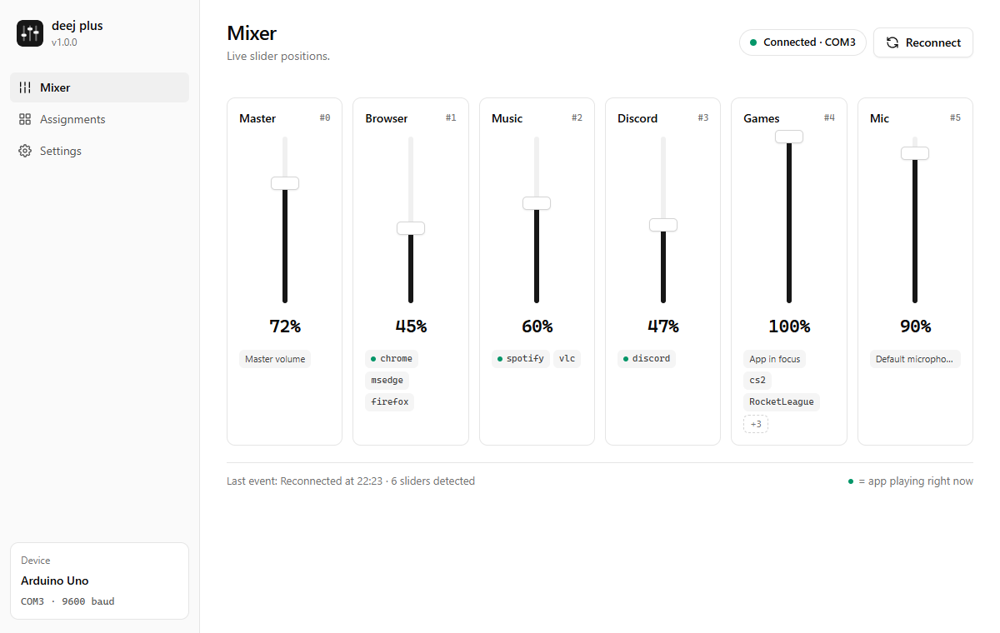

# deej plus

**deej plus** è un fork mantenuto di [deej](https://github.com/omriharel/deej), il mixer di volume hardware open source di [Omri Harel](https://github.com/omriharel): slider veri su un Arduino che regolano il volume di ogni app del PC (musica, gioco, chat vocale) senza interrompere quello che stai facendo.

Mantiene l'hardware, il protocollo seriale e il `config.yaml` di deej, e aggiunge quello che mancava: **si ricollega da solo**, ha una **finestra per impostare tutto** invece di modificare un file, un **filtro anti-rumore migliore** e un **installer**.

[Read in English](README.md) · [Download](https://github.com/DoctorFrank28/deej-plus/releases/latest) · [Novità](CHANGELOG.md)

## Cosa cambia rispetto a deej

- **Riconnessione automatica.** Stacchi il cavo, il PC va in sospensione, un altro programma occupa la porta: deej plus continua a provare e riprende la scheda in pochi secondi, con una notifica quando si scollega e una quando torna. L'originale smetteva di leggere per sempre.
- **Trova la scheda da solo.** Con `com_port: auto` cerca l'Arduino dal suo ID USB: non importa se Windows lo sposta da COM3 a COM5.
- **Una finestra per tutto.** Icona nel tray → *Apri deej plus*:
  - **Mixer**: tutti gli slider dal vivo, con le app che comandano e un pallino su quelle che stanno suonando.
  - **Assegnazioni**: dai un nome agli slider e scegli le app tra quelle che fanno audio, senza scrivere nomi di processo.
  - **Impostazioni**: porta, riconnessione, filtro anti-rumore con anteprima dal vivo, avvio con Windows, lingua.
  - Le modifiche vanno direttamente in `config.yaml`, commenti compresi. Modificare il file a mano funziona ancora.
- **Un filtro che non va a scatti.** L'originale ignorava ogni variazione sotto il 2,5%, quindi il volume si muoveva a scatti di circa il 3%. Il nuovo filtro usa l'isteresi: uno slider fermo non tremola, uno slider che muovi segue all'1%, e agli estremi arriva esattamente a 0% e 100%. Preset più valori su misura.
- **Firmware con filtro sulla scheda** ([`arduino/deej-6-sliders-filtered`](arduino/deej-6-sliders-filtered/deej-6-sliders-filtered.ino)): fa la media delle letture, manda solo i cambi veri più un segnale ogni secondo, scala piena 0–1023. Qualsiasi sketch di deej funziona comunque.
- **Installer** per Windows, per utente (senza permessi di amministratore). Si porta dietro il `config.yaml` di un deej già installato.
- **Istanza singola**: se lo avvii due volte ti mostra la finestra di quello già aperto.
- **Italiano e inglese**, secondo la lingua di Windows. Per aggiungere una lingua basta un blocco di testi.

## Installazione

1. **Costruisci l'hardware** come nella [guida di deej](https://github.com/omriharel/deej#build-your-own) (slider, Arduino, qualche filo).
2. **Carica uno sketch** sulla scheda: consigliato [`deej-6-sliders-filtered`](arduino/deej-6-sliders-filtered/deej-6-sliders-filtered.ino). Imposta `NUM_SLIDERS` e l'elenco dei pin secondo il tuo cablaggio: il primo pin dell'elenco è lo slider 0 del config. [Come funzionano gli sketch e come caricarli](arduino/README.it.md).
3. **Avvia l'installer** `deej-plus-setup-<versione>.exe` dalle [release](https://github.com/DoctorFrank28/deej-plus/releases/latest). Arrivi da deej? Chiudilo prima: l'installer copia il suo `config.yaml`.
4. deej plus apre la sua finestra: assegna le app agli slider e hai finito.

Requisiti: Windows 10 o 11 (x64). Su Linux si compila, ma non è provato.

La tabella completa delle chiavi del config, l'API locale e la compilazione sono nel [README in inglese](README.md#configuration).

## Crediti e licenza

deej plus nasce da [deej](https://github.com/omriharel/deej) di Omri Harel, con licenza MIT, e resta MIT: vedi [LICENSE](LICENSE). Il progetto hardware, il client originale e le build della community sono lavoro suo e della community di deej; se deej plus ti è utile, valuta di [sostenere il progetto originale](https://ko-fi.com/omriharel).

Problemi e idee su deej plus: [issue su GitHub](https://github.com/DoctorFrank28/deej-plus/issues). Non segnalare i problemi di deej plus al progetto originale.
