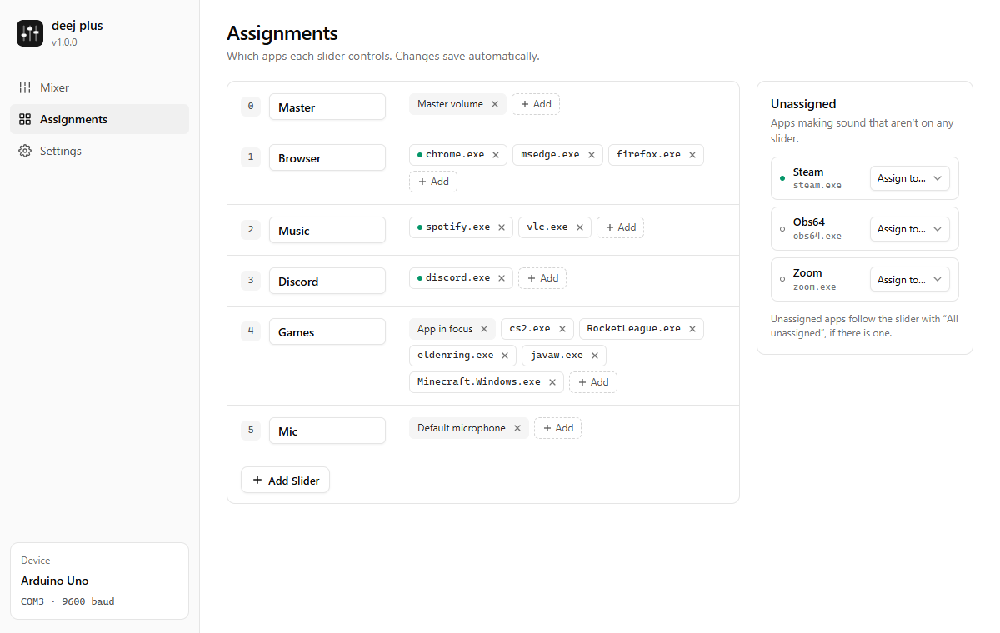
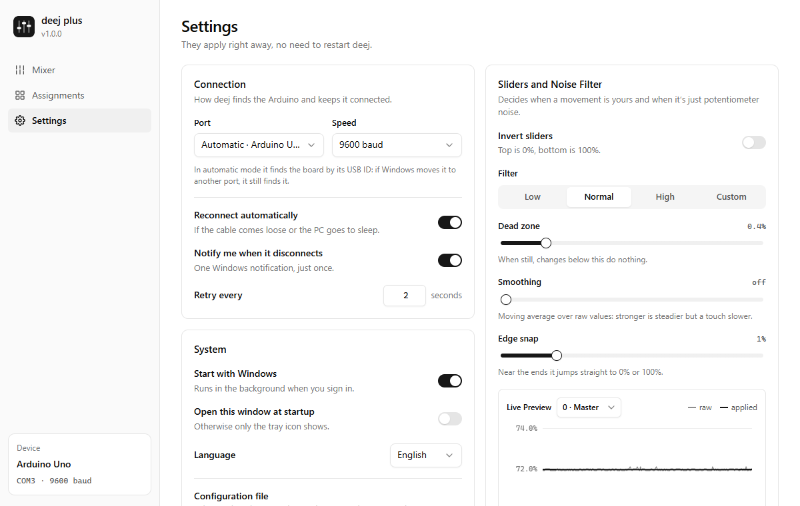

# deej plus

**deej plus** is a maintained fork of [deej](https://github.com/omriharel/deej), the open-source hardware volume mixer by [Omri Harel](https://github.com/omriharel): real sliders on an Arduino that control the volume of each app on your PC (music, game, voice chat) without leaving what you're doing.

It keeps deej's hardware, serial protocol and `config.yaml`, and adds what the original was missing: it **reconnects by itself**, has a **window to set everything up** instead of editing a file, a **better noise filter**, and an **installer**.

[Leggimi in italiano](README.it.md) · [Download](https://github.com/DoctorFrank28/deej-plus/releases/latest) · [Changelog](CHANGELOG.md)


## What's new compared to deej

- **Automatic reconnection.** Unplug the cable, put the PC to sleep, or have another program grab the port: deej plus keeps trying and picks the board up again within seconds, with one notification when it drops and one when it's back. The original stopped reading for good.
- **Finds the board by itself.** `com_port: auto` looks for the Arduino by its USB id, so it doesn't matter if Windows moves it from COM3 to COM5.
- **A window for everything.** Tray icon → *Open deej plus*:
  - **Mixer**: every slider live, with the apps it controls and a dot on the ones playing right now.
  - **Assignments**: name your sliders and pick apps from the ones making sound, no process names to type.
  - **Settings**: port, reconnection, noise filter with a live preview, start with Windows, language.
  - Changes go straight into `config.yaml`, comments included. Editing the file by hand still works.
- **A noise filter that doesn't feel steppy.** The original ignored every change under 2.5%, so volume moved in ~3% steps. The new filter uses hysteresis: a slider at rest never flickers, a slider you move follows in 1% steps, and the ends snap to exactly 0% and 100%. Presets plus custom values.
- **Firmware with on-board filtering** ([`arduino/deej-6-sliders-filtered`](arduino/deej-6-sliders-filtered/deej-6-sliders-filtered.ino)): averages readings, sends only real changes plus a once-a-second heartbeat, full 0–1023 range. Any deej sketch still works.
- **Installer** for Windows, per user (no admin rights). It brings along the `config.yaml` of an existing deej install.
- **Single instance**: starting it twice just shows the window of the running one.
- **English and Italian**, following the Windows language. Adding a language is one block of strings.

| Assignments | Settings |
|---|---|
|  |  |

## Install

1. **Build the hardware** as in the [original deej guide](https://github.com/omriharel/deej#build-your-own) (sliders, Arduino, a few wires).
2. **Upload a sketch** to the board: [`deej-6-sliders-filtered`](arduino/deej-6-sliders-filtered/deej-6-sliders-filtered.ino) is recommended. Set `NUM_SLIDERS` and the pin list to match your wiring: the first pin in the list is slider 0 in the config. [How the sketches work and how to upload them](arduino/README.md).
3. **Run the installer** `deej-plus-setup-<version>.exe` from the [releases](https://github.com/DoctorFrank28/deej-plus/releases/latest). Coming from deej? Quit it first; the installer copies its `config.yaml`.

   > **Windows SmartScreen** may say *"Windows protected your PC"*: deej plus isn't code-signed (a signing certificate costs money every year), so Windows doesn't know the publisher yet. Click **More info → Run anyway**. The installer is built from this repository's source by [GitHub Actions](https://github.com/DoctorFrank28/deej-plus/actions), so you can check where every release comes from.
4. deej plus opens its window: assign apps to your sliders and you're done.

Requirements: Windows 10 or 11 (x64). Linux builds from source but is untested at runtime.

## Configuration

Everything is in `config.yaml` next to the program (`%LOCALAPPDATA%\Programs\deej-plus`), and the window edits it for you. On top of deej's keys:

| Key | Default | What it does |
|---|---|---|
| `com_port` | `auto` | `auto` finds the board by USB id, or a port like `COM4` |
| `auto_reconnect` | `true` | keep trying when the board is gone |
| `reconnect_interval` | `2` | seconds between attempts |
| `serial_timeout` | `0` | seconds of silence after which the link counts as dead (`0` = never). Set it to `3` with the filtered sketch, which sends a heartbeat |
| `notify_on_disconnect` | `true` | notification when the board drops and comes back |
| `slider_max_value` | `1023` | the value your sketch sends at the top |
| `slider_names` | none | names shown in the window, e.g. `0: Master` |
| `noise_reduction` | `default` | `low`, `default`, `high` or `custom` |
| `noise_filter` | | used with `custom`: `deadband` (%), `smoothing` (0–0.9), `edge_snap` (%) |
| `language` | `auto` | `auto`, `en` or `it` |
| `ui_port` | `47823` | local port of the window |
| `open_ui_on_start` | `false` | open the window when deej plus starts |

Slider targets are the same as deej's: process names (`chrome.exe`), `master`, `mic`, `system`, `deej.current` (app in focus), `deej.unmapped` (everything not assigned) and device names.

## The window and its local API

The window is a small web page served by deej plus on `127.0.0.1` only and opened as an app window (Edge, falling back to your browser). It talks to a local JSON API (`/api/state`, `/api/sessions`, `/api/settings`, `/api/mapping`, `/api/events` as Server-Sent Events). Requests from other hosts are refused, and every change needs a custom header, so a website can't change your settings.

## Build from source

Requirements: Go (version in `go.mod`), and [Inno Setup 6](https://jrsoftware.org/isinfo.php) for the installer (`winget install JRSoftware.InnoSetup`).

```bat
go test ./pkg/deej/...
pkg\deej\scripts\windows\build-installer.bat 1.0.0
```

The installer lands in `releases\`. Icons are drawn by `go run ./tools/genicons`; the Windows resources (manifest and icon) by `pkg\deej\scripts\windows\make-rsrc.bat`. Pushing a `v*` tag builds the installer on GitHub Actions and drafts a release.

## Credits and license

deej plus is built on [deej](https://github.com/omriharel/deej) by Omri Harel, MIT licensed, and stays MIT licensed: see [LICENSE](LICENSE). The hardware design, the original client and the community builds are all his and the deej community's work; if deej plus is useful to you, consider [supporting the original project](https://ko-fi.com/omriharel).

Issues and ideas for deej plus: [GitHub issues](https://github.com/DoctorFrank28/deej-plus/issues). Please don't report deej plus problems to the original project.
